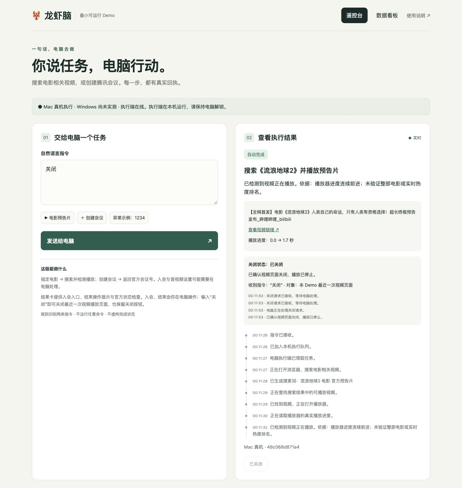

# 🦞 龙虾遥控台 · Lobster Remote

**一句话，让电脑行动。**

这是围绕“龙虾脑”AI 产品经理面试题实现的最小可运行 Demo：在手机或电脑网页输入自然语言，让本机执行指定电影相关视频播放、腾讯会议创建，并回传实际状态。附产品方案、数据看板、启动说明和录屏脚本。

> 当前已验证 **Mac 真机**。提供 Windows 启动脚本与适配，但尚未完成 Windows 真机验收。运行时采用有限规则识别，AI 用于辅助编码；不是通用大模型电脑操作系统。

## 可以做什么

| 输入或操作 | 实际行为 | 完成依据 |
| --- | --- | --- |
| `搜索《流浪地球2》并播放预告片` | 在电脑搜索并播放匹配的相关视频 | 播放器媒体时间前进 |
| `关闭` / `关闭播放界面` / `关掉这个视频` | 关闭本 Demo 最近一次执行的视频页面，无需点击关闭按钮 | 确认该页面已关闭 |
| `创建一个腾讯会议` | 通过腾讯官方工具创建会议，返回会议号 | 官方创建响应 |
| 结果卡“打开此会议的入会入口” | 打开该会议的客户端链接，用户完成必要提示 | 官方会议状态及本机账号参会记录 |
| 结果卡“结束会议（电脑确认）” | 用户在客户端选择“全员结束会议”，网页查询结果 | 腾讯官方“已结束”状态 |
| 结果卡“取消未开始的预约” | 取消本 Demo 创建且尚未进行的会议预约 | 官方取消成功回执 |
| `加入腾讯会议，会议码1234` | 拦截格式不正确的会议号并提示修正 | 参数校验结果 |

“关闭”只作用于本 Demo 最近的视频任务，不会退出整个浏览器或结束腾讯会议。视频关闭与会议功能共存。创建会议、打开客户端、入会、结束、取消预约分别记录，不互相冒充。

## 三步启动（Mac）

1. 安装 Python 3.10 或更高版本、Google Chrome；安装腾讯会议并登录。
2. 下载本仓库 ZIP 并解压，双击 **启动Mac.command**。首次启动会安装 Playwright 依赖，需要网络。若脚本无法直接打开，可在项目目录的终端执行 `bash 启动Mac.command`。
3. 电脑浏览器访问 **http://127.0.0.1:8765/**，输入启动窗口显示的配对码。保持启动窗口运行、电脑解锁。

手机与电脑连接同一可信 Wi-Fi，在手机输入启动窗口显示的局域网地址和配对码。**手机不能使用 `127.0.0.1`，它指向手机自身。** 若出现多个地址，应选电脑实际 Wi-Fi 网卡地址。

需要创建会议时，先双击 **授权腾讯会议.command**，由你在腾讯官方页面登录并授权。**客户端登录与官方工具授权是两个独立步骤**，应使用同一演示账号。无需开通 Mac 辅助功能权限，本版不使用 AppleScript。

Windows 使用 **启动Windows.bat**，需要 Python Launcher、Edge 和腾讯会议；官方工具授权使用 **授权腾讯会议Windows.bat**。本平台适配仍待真机测试。

只想看页面可运行 **预览Mac.command**；界面会明确标记预览，绝不执行电脑任务。

## 看板与说明

运行后点击顶部“数据看板”，可查看真实任务数、自动完成率、耗时、异常原因及关闭、入会和结束统计。人工结束后取得官方回执，单独统计为“已核验结束（人工操作）”，不算全自动会议结束。

- [启动与故障排查](static/guide.html)
- [产品方案、指标口径和后续规划](static/plan.html)
- [录屏顺序与口述脚本](static/recording.html)
- [验收记录与已知边界](static/verification.html)
- [结构化验收摘要](验收摘要.json)

HTML 文档下载后可直接用浏览器打开；程序运行时也可从网页底部进入。录屏由项目使用者完成。



## 实现与验证

本地 Python HTTP 服务提供网页、串行任务队列和 SQLite 记录；Playwright 操作本 Demo 专用浏览器；腾讯官方 tmeet 提供会议创建、查询和取消能力。网页轮询实际任务状态，不预置模拟成功数据。

Mac 已实测：电影搜索与播放、自然语言关闭视频、官方会议创建、入会状态核验、用户全员结束后的官方状态回传。**33 项回归检查通过**，包括创建会议后视频关闭不回退、重复请求不切换关闭对象、人工完成不混入自动成功等。

开发者在安装依赖后运行：

```bash
python3 -m unittest discover -s tests -v
```

自动测试使用临时数据库和测试替身，不操作真实会议，也不写入运行看板；它们与上述真机验收分别记录。

## 使用边界

- 当前只适用于可信局域网演示，不是已部署的公网远控服务；不要直接将端口暴露到公网。
- 仅识别两类有限任务及视频关闭指令，不执行任意自然语言命令，也不提供完整电影资源或实时热度排名。
- 登录、验证码、网络、播放器变化可能阻塞执行；没有证据时返回待处理或未知。
- 当前会议结束接口在本次授权下返回“该接口未开放”。按用户选择保留客户端人工入会、结束，系统自动核验。
- 会议创建超时不自动重试；重启不重放外部动作。重启前的视频无法定位时，不会假报关闭成功。
- Windows 真机和手机跨设备连接尚未完成本项目的验收；不能用 Mac 结果代替 Windows 验收。

## 文件与隐私

源码、启动脚本、文档、测试和必要的第三方可执行文件包含在仓库中。`.local-auth/`（腾讯授权）、`runtime/`（历史任务和浏览器会话）、`.venv/`、本机 `config.json` 均排除在版本管理之外。不会上传个人历史任务、配对码或包含实际会议信息的截图。

腾讯官方 tmeet 1.0.19 的来源与 MIT 许可证见 [第三方组件说明](第三方组件说明.txt) 和 [许可证原文](bin/TENCENT-LICENSE.txt)。浏览器执行依赖见 [requirements.txt](requirements.txt)。
